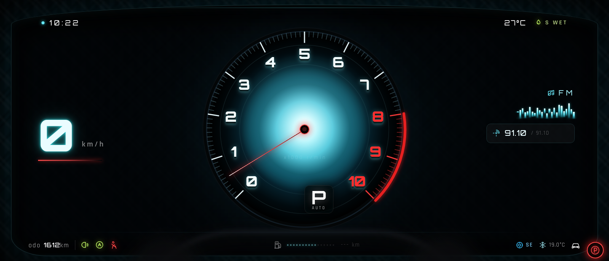

# DashboardMcLaren

Cluster digital ultrawide **21:9** no estilo McLaren GT / Artura, em React +
Tailwind CSS + framer-motion. Fundo preto com fibra de carbono sutil, glow cyan,
tacômetro gigante 0–10k com zona vermelha, ponteiro animado por mola, velocímetro,
mídia FM com waveform, barra inferior de status e volante desfocado em primeiro plano.



## Instalação

```bash
npm i react react-dom framer-motion
npm i -D tailwindcss postcss autoprefixer
```

1. Copie `DashboardMcLaren.jsx`, `dashboard.css` e (opcional) `tailwind.config.js`.
2. Importe o CSS uma vez no entrypoint:

```js
import "./ui/react/index.css"; // ou importe "./dashboard.css" diretamente
```

3. Se usar seu próprio `tailwind.config.js`, adicione:

```js
theme: {
  extend: {
    fontFamily: {
      display: ["Orbitron", "sans-serif"],
      body: ["Rajdhani", "sans-serif"],
    },
  },
}
```

> Os arquivos `dashboard.css` já definem `.font-display` / `.font-body` e importam
> Orbitron + Rajdhani do Google Fonts, então o componente funciona mesmo sem
> estender o tema. As fontes também podem ser auto-hospedadas para uso offline no
> carro.

## Uso

```jsx
import DashboardMcLaren from "./DashboardMcLaren";

export default function App() {
  const [rpm, setRpm] = useState(500);

  return (
    <DashboardMcLaren
      rpm={rpm}
      speed={0}
      gear="P"
      odo={1612}
      time="10:22"
      temp={27}
      fuel={0.62}
      fmFreq={91.1}
      mode="AUTO"
    />
  );
}
```

O componente ocupa a largura do container e mantém a proporção 21:9
(`aspect-ratio: 21 / 9`). Para kiosk em tela cheia, use um wrapper de `100vw`.

## Props

| Prop | Tipo | Padrão | Descrição |
|---|---|---|---|
| `rpm` | number | `500` | 0–10000; controla o ponteiro e a zona vermelha 8–10 |
| `speed` | number | `0` | Velocidade em km/h (número grande à esquerda) |
| `gear` | string | `"P"` | Letra grande no badge dentro do tacômetro |
| `odo` | number | `1612` | Odômetro em km |
| `time` | string | `"10:22"` | Relógio no topo esquerdo |
| `temp` | number | `27` | Temperatura ambiente (°C) no topo direito |
| `fuel` | number | `0.62` | Nível do tanque, 0–1 (barra pontilhada) |
| `fmFreq` | number | `91.1` | Frequência FM exibida no card de mídia |
| `mode` | string | `"AUTO"` | Texto pequeno abaixo do `gear` |

Valores são normalizados (`rpm` 0..10000, `fuel` 0..1) e nunca quebram o layout.

## Estrutura visual

- **Tacômetro**: SVG com gradiente radial cyan/branco, 101 ticks, números 0–7 em
  branco gelo e 8–10 em vermelho neon, arco vermelho 8–10, ponteiro em
  `motion.div` com mola, cubo vermelho vazado e badge P/AUTO no canto inferior
  direito interno.
- **Topo**: hora à esquerda; temperatura + `S WET` (ícone verde) à direita.
- **Esquerda**: velocidade grande + `km/h` + linha vermelha fina.
- **Direita**: ícone de rádio `FM`, waveform animado em cyan e card com radar +
  `91.10 / 91.10`.
- **Barra inferior**: `odo 1612km`, farol e AUTO em verde limão, cinto em
  vermelho; combustível com barra pontilhada e `--- km`; pneu `SE` azul, A/C
  `19.0°C` e ícone de carro branco.
- **Fora do cluster**: luz vermelha de freio de mão `(P)` no canto inferior
  direito.
- **Volante**: silhueta desfocada (`blur`) em primeiro plano, sem reflexos.

## Preview sem build

`preview.html` carrega React, framer-motion, Babel e Tailwind por CDN, busca o
próprio `DashboardMcLaren.jsx` e transpila no navegador. Sirva a pasta por HTTP:

```bash
python3 -m http.server 8765 --directory ui/react
# abra http://localhost:8765/preview.html          (rpm/speed animados)
# abra http://localhost:8765/preview.html?static=1  (valores do enunciado)
# abra http://localhost:8765/preview.html?static=1&rpm=7400&speed=128
```

Parâmetros aceitos no preview: `static`, `rpm` (0–10000) e `speed` (km/h).

Requer internet para os CDNs e para o Google Fonts. Para produção, prefira
instalar as dependências e compilar com Vite/Next (sem CDN).

## Observações

- Todos os tamanhos usam `cqw` (container query units); o painel escala junto com
  a largura, de 800 px a 2560 px.
- Não há imagens/bitmaps: textura, glow, arco e volante são CSS/SVG (leve para o
  Orange Pi/Raspberry Pi).
- `prefers-reduced-motion` não é detectado por padrão; para acessibilidade,
  desative as animações do waveform/ponteiro no seu app se necessário.
